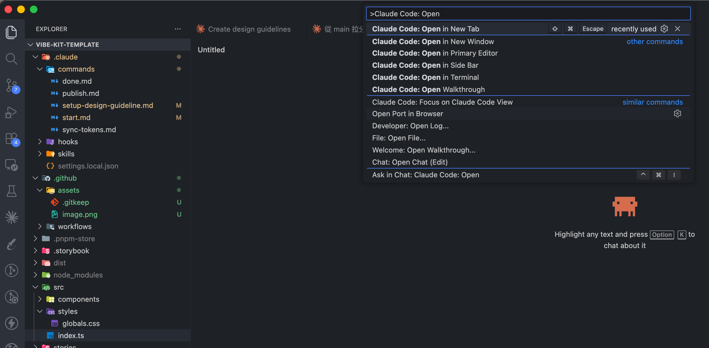
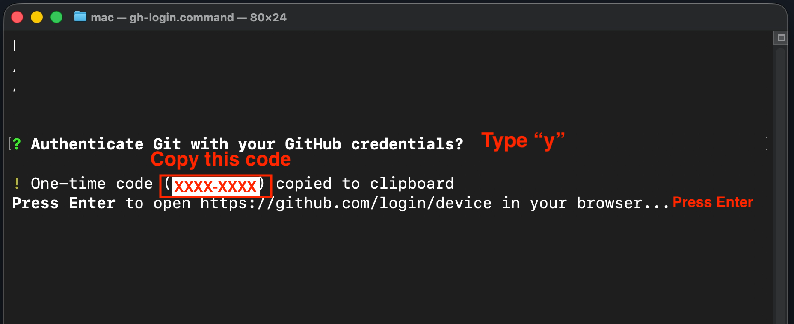
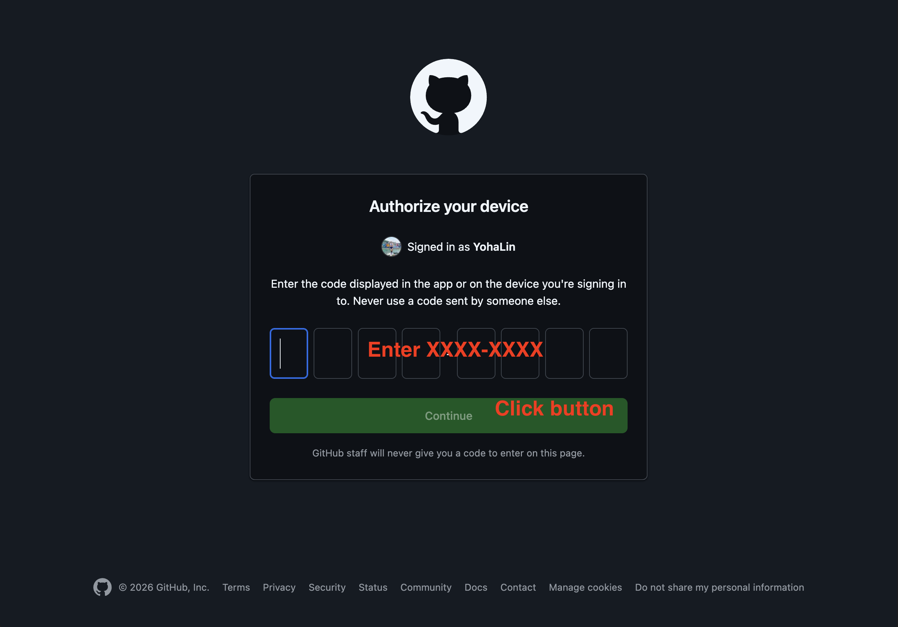
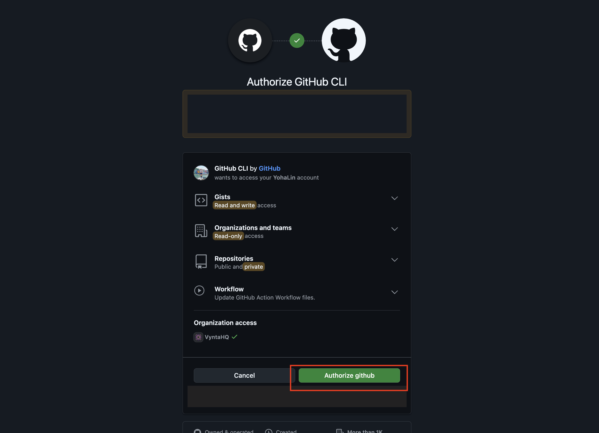
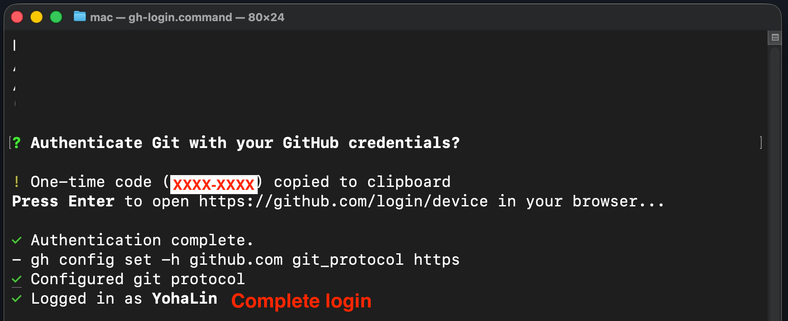
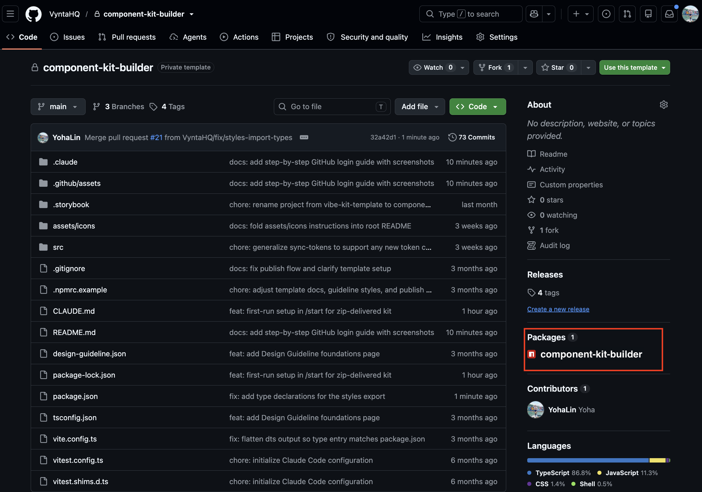
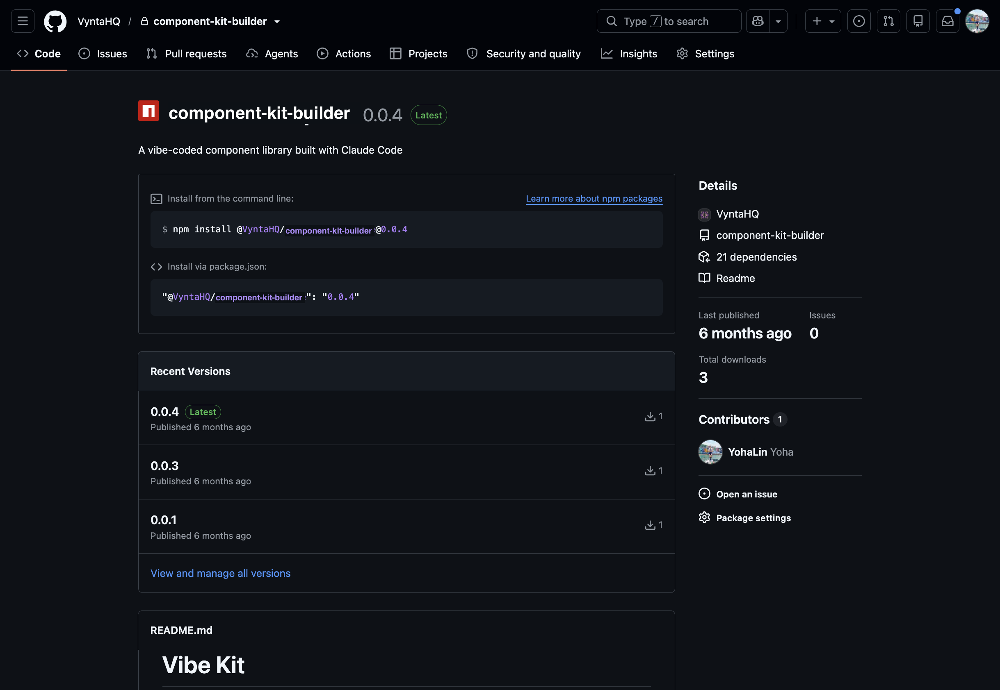
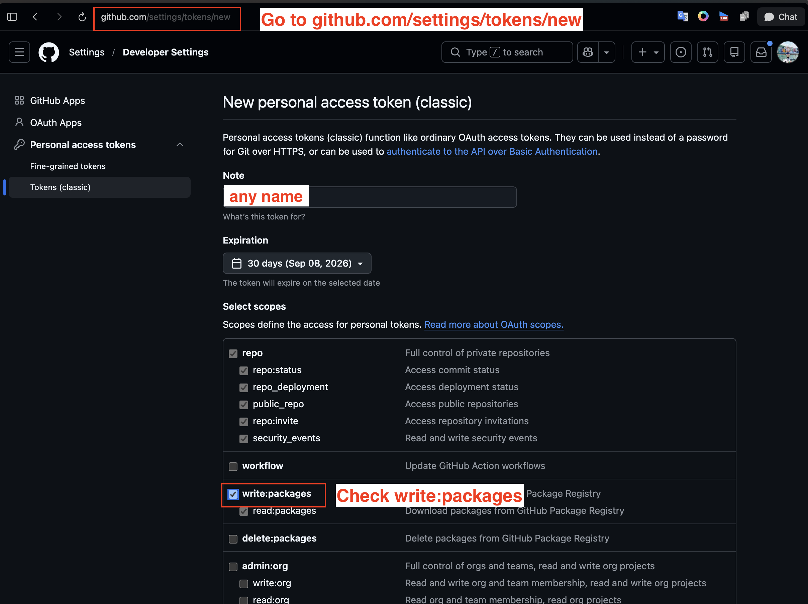
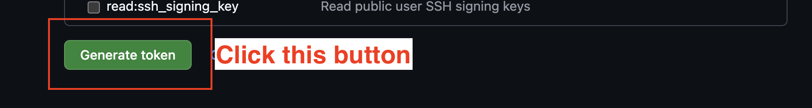
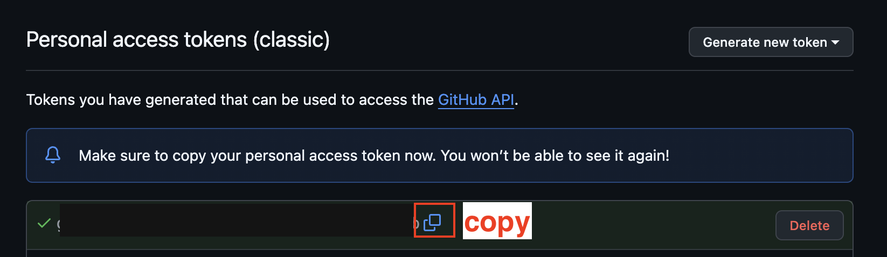

# Component Kit Builder

A kit for designers to build their own component library using Claude Code — no coding required.

Unzip the kit, open it in VS Code, and let AI set up your computer and generate the components.

---

## Prerequisites

| Tool | Version | Notes |
|------|---------|-------|
| Node.js | 22.12 or later | [nodejs.org](https://nodejs.org) — choose **LTS** |
| VS Code | Any recent | [code.visualstudio.com](https://code.visualstudio.com) |
| Claude Code | Latest | Install from VS Code Extensions (`anthropic.claude-code`) |
| Claude account | Pro or above | [claude.ai](https://claude.ai) — required to use Claude Code |
| GitHub account | Free is fine | [github.com/signup](https://github.com/signup) — where your library is saved and published |

> Don't worry about anything else (Git, GitHub CLI, etc.) — the first time you run `/start`, Claude checks your computer and installs whatever is missing.
>
> After installing Node.js, quit VS Code completely (**Cmd+Q** on Mac, close every window on Windows) and reopen it, so VS Code can find it.

---

## Step 1 — Open the Kit

**1. Unzip the file you received**

- **Mac:** double-click the zip file.
- **Windows:** right-click the zip file → **Extract All**. Don't open the folder from inside the zip without extracting it — VS Code won't be able to save your work.

**2. Rename the folder and put it somewhere safe**

- Rename the folder to your library's name, e.g. `my-design-system`. (Lowercase letters, numbers and hyphens work best.)
- Move it to a folder that **isn't synced to iCloud or OneDrive** — for example, create a `Projects` folder in your home folder. Syncing breaks the project. Your Desktop and Documents folders are often synced, so avoid those.

**3. Open in VS Code**

Open VS Code, then go to **File → Open Folder** and select the folder. If VS Code asks **"Do you trust the authors of the files in this folder?"**, click **Yes, I trust the authors**.

**4. Open Claude Code**

Press `Cmd+Shift+P` (Mac) or `Ctrl+Shift+P` (Windows) and search for **Claude Code: Open**, or click the Claude icon in the sidebar.



---

## Step 2 — Start a Working Session

Always run this first before making any changes:

```
/start
```

Claude will sync main, ask what you're working on, and create a feature branch. At the end, it will automatically open Storybook at [http://localhost:6006](http://localhost:6006) — a browser preview where you can see your components live.

### The first time takes longer (about 15–30 minutes)

The first `/start` also sets up your computer and saves the project to your GitHub. Claude explains each step as it goes. Here's everything you might be asked to do, in order:

1. **Click "Install"** *(Mac)* — if a window pops up asking to install developer tools. It takes 5–15 minutes.
2. **Type your Mac password** *(Mac)* — in a Terminal window Claude opens for you. **Nothing appears on screen while you type — that's normal.** Press Enter when done.
3. **Click "Yes"** *(Windows)* — if Windows asks "Do you want to allow this app to make changes to your device?"
4. **Log in to GitHub** *(only if this computer isn't logged in to GitHub yet)* — a window shows a short code and your browser opens GitHub. Paste the code, click **Authorize**, then come back to VS Code and tell Claude you're done. See [Logging in to GitHub, step by step](#logging-in-to-github-step-by-step) below. If you're already logged in another way, Claude uses that, but may ask you to log in once through the browser so it can create your repository — or you can create it yourself on GitHub, and Claude will tell you how.
5. **"What should your library be called?"** — Claude suggests your folder name. Just confirm, or type another name.
6. **"Which GitHub account or organization should this live under?"** — open that account's or organization's page on GitHub and paste its URL, e.g. `https://github.com/your-account-name`. Paste the page URL only — **don't create a repository on GitHub yourself**, Claude creates it for you. It's always created as **private**.
7. **"Which component are you working on today?"** — type a short description and hit Enter, e.g. `product card` or `navigation bar`.

From the second time on, `/start` only asks question 7.

> If anything gets interrupted (you closed a window, your computer went to sleep), just run `/start` again — it picks up where it left off.
>
> If Claude says you need admin rights or the network blocked a download, your computer is probably managed by your company — ask your IT team for help with what Claude describes.

### Logging in to GitHub, step by step

> **Only needed if this computer isn't logged in to GitHub yet.** If you've logged in to GitHub on this computer before, Claude detects it and skips this part — no window opens and you can skip this section.

If you do need to log in, Claude opens a Terminal window (PowerShell on Windows) for you. The screenshots below are from a Mac; Windows shows the same text.

**1. In the window Claude opened**

- When it asks **"Authenticate Git with your GitHub credentials?"**, type `y` and press Enter.
- A one-time code appears (like `XXXX-XXXX`). It's already copied for you — no need to write it down.
- Press **Enter** to open GitHub in your browser.



**2. In your browser, enter the code**

If GitHub asks you to sign in first, sign in with your GitHub account. Then paste the code (`Cmd+V` on Mac, `Ctrl+V` on Windows) and click **Continue**.



**3. Click "Authorize github"**

GitHub shows what GitHub CLI (the tool Claude uses to talk to GitHub) will be allowed to do. Click **Authorize github** at the bottom.

> If you belong to an organization, it may appear under **Organization access**. If there's an **Authorize** button next to it, click it too — otherwise you may not be able to use that organization later.



**4. Back in the window, check it worked**

When you see **"Logged in as <your username>"**, you're done. Close the window, go back to VS Code and tell Claude you're done.



> **Already use another way to log in to GitHub** (SSH key, GitHub Desktop, a saved password)? Claude detects it and uses it automatically, so you may never see these steps. If you'd rather set up one of those yourself, search online for how to set it up on your computer — GitHub's guides on [saving your login for Git](https://docs.github.com/en/get-started/git-basics/caching-your-github-credentials-in-git) and [SSH keys](https://docs.github.com/en/authentication/connecting-to-github-with-ssh) are good starting points.

> **Allow permissions when prompted:** Claude may ask for permission to run commands (e.g. installing tools, starting Storybook). Click **Allow** — these are safe operations and the flow will stall if you decline.

---

## Step 3 — Do Your Work

Each action requires its own command. Run the relevant command, let Claude finish, then run another one for the next task.

### `/setup-design-guideline`
*(First time only)* Claude will ask about your brand — colors, fonts, dark mode. You can answer with hex values, descriptions, or a Figma screenshot. Claude generates `design-guideline.json` for your confirmation before saving.

> If you're just attaching a file (e.g. a Figma screenshot) and aren't sure what to type along with it, paste this:
> ```
> Use the files I've attached to generate the design guideline.
> ```

If you already have a `design-guideline.json`, attach it when you run the command and Claude will use it directly — no questions asked.

> If anything goes wrong or you need to start over, just run `/setup-design-guideline` again.

Once it's saved, open Storybook → **Foundations → Design Guideline** to see your tokens WYSIWYG:

- Save `design-guideline.json` and Storybook shows the result immediately — no rebuild needed.
- Hover any color swatch to see which palette step it points to.
- A swatch with a ⚠ badge means that token hasn't been applied to the code yet — run `/sync-tokens` and it disappears.

### `/sync-tokens`
Applies `design-guideline.json` to Tailwind. Run this after `/setup-design-guideline`, or any time you update the file.

### `/setup-logo`
*(Optional)* Share your logo file (SVG works best) and Claude saves it into `design-guideline.json`. Open Storybook → **Foundations → Logos** to see it in place of the gray placeholder.

> The template ships with no logo — the Logos page shows an empty placeholder until you run this.

### `/generate-component`
> ⚠️ Only for brand-new components. To modify an existing one, use `/edit-component` instead.

Tell Claude what component you want — what it looks like, what variants or states it has. The more detail you provide, the better the result.

Things to include:
- **Variants** — e.g. primary, secondary, ghost, destructive
- **Sizes** — list every size you need, e.g. `xs`, `sm`, `md`, `lg`, `xl`
- **States** — e.g. default, hover, disabled, loading, active
- **Content** — what goes inside (icon, label, badge, avatar...)
- **Behavior** — e.g. full-width on mobile, icon-only at small sizes

> Example: "I want a Button with three variants: primary (solid), secondary (outlined), and ghost (text only). Sizes: sm, md, lg. States: default, hover, disabled, and loading (show a spinner)."

If the component needs a reusable spacing or radius value (e.g. a consistent card padding), tell Claude to add it as a semantic token in `design-guideline.json` and run `/sync-tokens` again — no need to plan these out ahead of time.

### `/edit-component`
Tell Claude what to change about an existing component.

> Example: "Add a loading spinner to the Button that appears when a `loading` prop is passed."

### `/sync-icons`
Drop icon SVG files into `assets/icons/`, then run this command. Claude turns each one into a ready-to-use icon component under `src/components/Icons/` and adds it to the icon gallery in Storybook → **Components → Icons**.

**Naming your files:** `icon_<name>_<type>.svg` — for example `icon_home.svg` becomes `HomeIcon`, and `icon_home_fill.svg` becomes `HomeFillIcon`. `<type>` is optional (only add it if you have variants of the same icon, like an outline and a filled version).

> If a file doesn't follow that pattern, Claude still converts it — it just uses the filename as-is (e.g. `arrow-right.svg` becomes `ArrowRightIcon`) instead of guessing what you meant.
>
> Removing a file from `assets/icons/` and running this again removes the matching component too.

---

## Step 4 — Save Your Work

When you're done, run:

```
/done
```

Claude saves your work and adds it to the main version of your library on GitHub — so the next `/start` begins from everything you've done so far, and `/publish` releases all of it. Repeat Steps 2–4 for each new batch of work.

> If you ever stop without running `/done`, don't worry — the next `/start` notices the unfinished work and asks what you'd like to do with it.

---

## Step 5 — Publish

> **First time only:** Your very first `/publish` includes a one-time setup (publish token, package scope, `.npmrc`) — Claude walks you through it automatically before publishing. See [Setup — Publishing to GitHub Packages](#setup--publishing-to-github-packages) below for details.

When you're ready to release the library, run:

```
/publish
```

Claude will build everything you've saved with `/done`, bump the version, publish to GitHub Packages, and push a release tag. If you have unsaved work, Claude will ask you to run `/done` first.

**How to choose a version:**

| Version | When to use | Example |
|---------|-------------|---------|
| `patch` | Fixed a bug, tweaked spacing or color | `0.0.1 → 0.0.2` |
| `minor` | Added a new component or new props | `0.0.1 → 0.1.0` |
| `major` | Renamed or removed existing components/props | `0.0.1 → 1.0.0` |

Use `major` only when existing users need to update their code after upgrading.

### Check that it was published

When `/publish` finishes, Claude gives you a link straight to your package page. You can also check it yourself on GitHub anytime:

**1. Open your repository's main page on GitHub**

On the right side, under **Packages**, you should see your library's name. If **Packages** isn't there, or your library isn't listed, the release didn't go through — tell Claude, or run `/publish` again.



**2. Click the library name to open the package page**

Check that the version at the top is the one you just released, marked **Latest**. **Recent Versions** lists every version you've released.



> The install command on this page may show the account or organization name with capital letters (e.g. `@VyntaHQ/...`). Frontend engineers should type it **all in lowercase** (e.g. `@vyntahq/...`) — see [For Frontend Engineers](#for-frontend-engineers--installing-the-component-library).

---

## Reference Commands

| Command | When to use |
|---------|-------------|
| `/setup-design-guideline` | Generate `design-guideline.json` from your brand description |
| `/sync-tokens` | Apply `design-guideline.json` to Tailwind after any updates |
| `/setup-logo` | Save your logo into `design-guideline.json` so it shows on the Logos page |
| `/start` | Sync main, create a feature branch, and start Storybook |
| `/generate-component` | Add a brand-new component (not for editing existing ones) |
| `/edit-component` | Modify an existing component (always use this, not `/generate-component`) |
| `/sync-icons` | Turn SVG files in `assets/icons/` into icon components |
| `/done` | Save your work and add it to the main version |
| `/publish` | Build, bump version, and release to GitHub Packages |
| `/core-components` | Look up component writing conventions and Design System tokens |
| `/storybook` | Look up how to write Storybook stories |
| `/spec-component` | Write a component spec before generating |
| `/design-guideline-page` | Look up the Design Guideline preview page's structure and conventions |

---

## Preview Components

```bash
npm run storybook
```

Opens Storybook at http://localhost:6006

---

## Setup — Publishing to GitHub Packages

The first time you run `/publish`, it needs a one-time setup — a publish token, a scoped package name, and a filled-in `.npmrc`. Most of this is automatic: `/publish` detects when it's missing and walks you through it step by step, right in the chat.

The one part that's manual is generating the token itself — that has to happen on GitHub's website, in your own logged-in account, so Claude can't do it for you. Here's what that looks like:

**1. Go to [github.com/settings/tokens/new](https://github.com/settings/tokens/new)** — give the token any name you like, and under **Select scopes**, check **only `write:packages`**. Leave everything else (`repo`, `workflow`, `admin:org`, etc.) unchecked — that one box is all `/publish` needs. Set **Expiration** to a long period (e.g. 1 year) — when the token expires, `/publish` stops working until you make a new one, and Claude will walk you through that if it happens.



**2. Click "Generate token"** at the bottom of the page.

> **Repo under an organization?** After generating, if you see a **Configure SSO** button next to the token, click it and **Authorize** your organization — otherwise the organization rejects the token.



**3. Copy the token immediately** — GitHub only shows it once.



Once you have it copied, run `/publish` — Claude will tell you exactly where to paste it (into `.npmrc`, not in the chat, since it's a secret).

### Who can see your published library

Your library is visible to the same people who can see your repo:

- **Repo under your personal account** — only people you add to the repo can install it. Add each frontend teammate under your repo's **Settings → Collaborators**.
- **Repo under an organization** — anyone in the organization with access to the repo can install it.

> If your library is meant for a whole team, putting it under your company's organization (question 6 of your first `/start`) is easier to manage than adding people one by one.

---

## For Frontend Engineers — Installing the Component Library

Throughout the steps below, the scope (`@...`) is whatever the library was published under — an organization name, or the author's GitHub username, **always in all lowercase** (e.g. `VyntaHQ` → `@vyntahq`). Use the actual package name you were given in place of `@your-org/your-library-name`.

**Before you start:** you need read access to the library's GitHub repo — either as a collaborator on the author's personal repo, or as an organization member with access to it. Without it, install fails with a 404 or 403 error. GitHub Packages always requires a token to install, even for public packages.

### Step 1: Generate a GitHub Personal Access Token

1. Go to [github.com/settings/tokens/new](https://github.com/settings/tokens/new)
2. Select **Classic token**
3. Check **only** `read:packages`
4. Generate and copy the token
5. If the library belongs to an organization and you see **Configure SSO** next to the token, click it and **Authorize** that organization

### Step 2: Add `.npmrc` to your project root

```
# Organization account
@your-org:registry=https://npm.pkg.github.com
//npm.pkg.github.com/:_authToken=YOUR_TOKEN_HERE

# Personal account (username: janedoe)
@janedoe:registry=https://npm.pkg.github.com
//npm.pkg.github.com/:_authToken=YOUR_TOKEN_HERE
```

Add `.npmrc` to your `.gitignore` so the token is never committed. You only set this up once.

> **Tip:** Alternatively, put the `_authToken` line in `~/.npmrc` (your home directory) and keep only the `@scope:registry=...` line in the project's `.npmrc`. That project file has no secret, so it can be committed and shared with your team.

### Step 3: Install

```bash
# Organization account
npm install @your-org/your-library-name@<version>

# Personal account (username: janedoe)
npm install @janedoe/your-library-name@<version>
```

### Step 4: Import styles

```tsx
import '@your-org/your-library-name/styles'
```

### Step 5: Use components

```tsx
import { Button } from '@your-org/your-library-name'

<Button variant="primary">Click me</Button>
```
